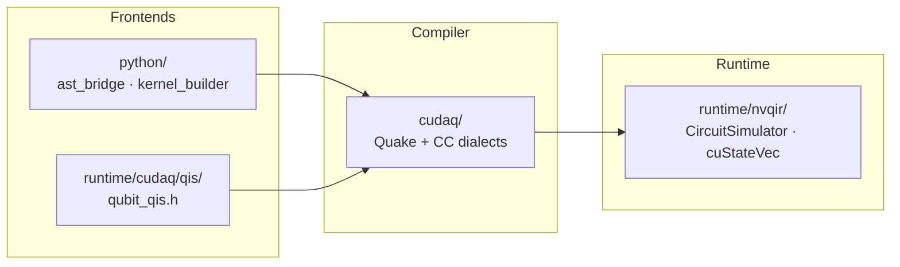

<div align="center">

# QUANTUM-CUDA

**Contribution work for [NVIDIA CUDA-Q](https://github.com/NVIDIA/cuda-quantum)** — analysis, verification, and the patches behind upstream documentation fixes.

[](https://github.com/NVIDIA/cuda-quantum/pull/5459)
[](https://github.com/NVIDIA/cuda-quantum/pull/5608)
[](https://github.com/NVIDIA/cuda-quantum/pull/5609)
[](#running-the-verification)
[](LICENSE)

</div>

---

## Contributions

| PR | Status | Change | Verification |
| :--- | :--- | :--- | :--- |
| [#5459](https://github.com/NVIDIA/cuda-quantum/pull/5459) | Merged 2026-09-24 | Document `exp_pauli`, `givens_rotation` and `fermionic_swap`; fix the sign in the `applyExpPauli` doc comment. Closes [#2141](https://github.com/NVIDIA/cuda-quantum/issues/2141). | [`verify_gates.py`](verification/verify_gates.py), numerical, 4/4 |
| [#5608](https://github.com/NVIDIA/cuda-quantum/pull/5608) | Open | Fix the custom `KrausChannel` example under `cudaq.apply_noise`, which crashes as printed. First item of [#5181](https://github.com/NVIDIA/cuda-quantum/issues/5181). | [`verify_apply_noise_example.py`](verification/verify_apply_noise_example.py), runtime, 5/5 |
| [#5609](https://github.com/NVIDIA/cuda-quantum/pull/5609) | Open | Document how a `qvector` can be passed to a custom operation in Python vs C++. Requested in [#4961](https://github.com/NVIDIA/cuda-quantum/issues/4961). | [`verify_custom_op_qvector.py`](verification/verify_custom_op_qvector.py), runtime, 7/7 |

> [!NOTE]
> The rule for every PR here: nothing is transcribed from existing comments or
> issue text. Each claim is recomputed from what CUDA-Q actually does — the gate
> sequences it executes, or the installed runtime itself — and the script that
> does it is in [`verification/`](verification/). That rule caught a sign error
> in #5459, and a mistake in the issue text behind #5608.

## What's here

| Path | Contents |
| :--- | :--- |
| [`verification/verify_gates.py`](verification/verify_gates.py) | #5459 — standalone numerical check of every matrix and sign convention. Requires only `numpy`. |
| [`verification/verify_apply_noise_example.py`](verification/verify_apply_noise_example.py) | #5608 — extracts the docs example from the `.rst` source and runs it against the installed `cudaq`. |
| [`verification/verify_custom_op_qvector.py`](verification/verify_custom_op_qvector.py) | #5609 — runs every Python call form the new note describes against the installed `cudaq`. |
| [`patches/`](patches/) | Each upstream commit as a `git format-patch` export, DCO sign-off intact. |

---

## PR #5459 — `exp_pauli`, `givens_rotation` and `fermionic_swap`

> Merged 2026-09-24 by @sacpis. Closes #2141.

CUDA-Q ships three quantum operations that user code can reach but the
documentation never mentions: `exp_pauli`, `givens_rotation` and
`fermionic_swap`. [Issue #2141](https://github.com/NVIDIA/cuda-quantum/issues/2141)
reports the gap and asks directly — *"in the first place, what is `givens`?"*

[**PR #5459**](https://github.com/NVIDIA/cuda-quantum/pull/5459) documents all
three. While pinning down the convention to document, it also turned up a sign
error in the doc comment on the simulator method that every backend overrides.

### The bug

The doc comment on `CircuitSimulator::applyExpPauli` claimed the method applies
`exp(-i·θ·P)`. It does not.

The base implementation performs a basis change, a CNOT ladder, and then
`rz(-2.0 * theta)` on the ladder target. Since `rz(a) = exp(-i·a·Z/2)`,
substituting `a = -2θ` gives `exp(+i·θ·Z)` — so the operation as a whole applies
the **positive** convention.

Four other descriptions in the tree already said so:

| Location | States |
| :--- | :--- |
| `Optimizer/Dialect/Quake/QuakeOps.td` | `applies exp(i theta P)` |
| `runtime/cudaq/builder/kernel_builder.h` | `exp(i theta P)` |
| `python/cudaq/kernel/kernel_builder.py` | `exp(i theta P)` |
| `python/cudaq/qis/qis.py` | `exp(i theta P)` |
| **`runtime/nvqir/CircuitSimulator.h`** | **`exp(-i theta ...)`** ← the outlier |

It matters because `applyExpPauli` is the virtual method each simulator backend
overrides, so its comment is the description a backend author reads first. The
fix is comment-only; no behavior changes.

### Verification

```console
$ python3 verification/verify_gates.py
Givens matrix matches the exp_pauli pair:        True
Fermionic SWAP matrix matches the gate sequence: True
applyExpPauli decomposition == exp(+i theta P):  True
applyExpPauli decomposition == exp(-i theta P):  False
r1(x) == exp(i*x/2) * rz(x):                     True

All checks passed.
```

Lines three and four are the pair that caught the sign error — the decomposition
matches the positive convention and fails the negative one.

<details>
<summary><b>What each check does</b></summary>

<br>

1. **Givens** — rebuilds the matrix from the two `exp_pauli` calls in
   `runtime/cudaq/kernels/givens_rotation.h` and compares against the documented
   form.
2. **Fermionic SWAP** — replays the full eighteen-gate sequence from
   `runtime/cudaq/kernels/fermionic_swap.h`, global phase correction included.
3. **`exp_pauli` sign** — rebuilds the `applyExpPauli` decomposition and tests it
   against *both* conventions, so the result distinguishes them rather than
   merely confirming one.
4. **`r1` vs `rz`** — shows the two differ only by a global phase of
   `exp(i·x/2)`, which is why they are distinct gates despite identical verbal
   descriptions.

Matrix exponentials use the closed form `exp(i·t·P) = cos(t)·I + i·sin(t)·P`,
valid because a Pauli tensor product squares to the identity — so `scipy` is not
needed. Qubit ordering is big-endian (q0 most significant), matching the
convention CUDA-Q uses for multi-qubit operator matrices.

</details>

### The change

1. **`exp_pauli` section** added to the Quantum Operations reference page: the
   `exp(i·θ·P)` convention, the rule that Pauli characters map to target qubits
   in order — so word length must equal target count — and both supported call
   forms in Python and C++.
2. **`givens_rotation` and `fermionic_swap`** added to the Python API reference.
   Both are `PyKernel` methods, but neither appeared in the `automethod` list, so
   they never rendered at all. Their docstrings now carry the definition and
   unitary matrix of each rotation.
3. **The sign comment** on `applyExpPauli` corrected.

Four files, +72 / −5. Review feedback from @sacpis — Python's `exp_pauli`
dispatches its arguments by type, so only C++ requires the Pauli word to precede
the qubits — was addressed before merge.

#### Scope left to the maintainers

Two questions were raised on the issue rather than settled unilaterally:

- On the C++ side, `givens_rotation` and `fermionic_swap` live in
  `cudaq_internal::` under `runtime/cudaq/kernels/`, which `CppAPICodingStyle.md`
  designates as internal, and they are referenced only from
  `unittests/nvqpp/integration/gate_library_tester.cpp`. They were therefore not
  presented as public C++ operations.
- `cudaq.lib.givens` and `cudaq.lib.fermionic_swap` are reachable as
  `@cudaq.kernel` functions, but `cudaq.lib` is otherwise undocumented, so they
  were not promoted either.

---

## PR #5608 — custom `KrausChannel` example under `cudaq.apply_noise`

> Open. Fixes the first item of #5181.

The Python API reference shows how to register a custom noise channel for
`cudaq.apply_noise`. As printed, the example cannot be used: the constructor is
written at the same indentation as the class, so it is a module-level function
rather than a method.

```python
class CustomNoiseChannel(cudaq.KrausChannel):
    num_parameters = 1
    num_targets = 1

def __init__(self, params: list[float]):   # ← outside the class
    cudaq.KrausChannel.__init__(self)
    ...
```

The class silently falls back to the base constructor, so the failure only shows
up later and far from its cause:

- `CustomNoiseChannel([0.1])` raises `RuntimeError: std::bad_cast`;
- passing the channel to `cudaq.apply_noise` terminates the interpreter with
  `SIGABRT`.

### A correction to the issue

Issue #5181 also says the trailing `noise = cudaq.NoiseModel()` /
`noise.register_channel(...)` lines are indented inside `__init__` and never run.
Extracting the block from the `.rst` source rather than reading the rendered page
shows that they are already at module level. The only defect is the placement of
`__init__`, so the fix is smaller than the issue suggests.

### Verification

The script pulls the code block out of `python_api.rst` exactly as Sphinx renders
it, then runs it against the installed `cudaq` on `density-matrix-cpu`. Every
runtime step is a separate subprocess, because the unfixed block aborts the
interpreter.

```console
$ python3 verification/verify_apply_noise_example.py ../cuda-quantum   # main
__init__ is a method of CustomNoiseChannel: False
register_channel runs at module level:      True
class matches test_NoiseModel.py:           False
constructs; Kraus ops sum to identity:      False
apply_noise gives P(0) = 0.1 +/- 0.01:      False
  construct: RuntimeError: std::bad_cast (exit 1)
  apply_noise: libc++abi: terminating due to uncaught exception of type nanobind::python_error: RuntimeError: std::bad_cast (exit -6)

Checks FAILED.

$ python3 verification/verify_apply_noise_example.py ../cuda-quantum   # with the patch
__init__ is a method of CustomNoiseChannel: True
register_channel runs at module level:      True
class matches test_NoiseModel.py:           True
constructs; Kraus ops sum to identity:      True
apply_noise gives P(0) = 0.1 +/- 0.01:      True
  measured P(0) = 0.0985

All checks passed.
```

<details>
<summary><b>What each check does</b></summary>

<br>

1. **Method placement** — parses the block with `ast` and checks `__init__` is in
   the class body.
2. **Registration** — checks `register_channel` is a top-level statement. This is
   the check that disproved the second half of the issue text.
3. **Matches the tested class** — compares the documented class with the
   `CustomNoiseChannel` in `python/tests/builder/test_NoiseModel.py` by AST
   equality, so the docs now show exactly what CI exercises.
4. **Valid channel** — constructs the channel and checks the completeness
   relation `Σ Kᵢ†Kᵢ = I`.
5. **Physical behavior** — the channel is a bit flip with probability `p`. After
   `x(q)` and `apply_noise(CustomNoiseChannel, 0.1, q)`, 20 000 shots should
   measure `0` about 10% of the time. The standard error is about 0.0021, so
   the ±0.01 band is close to five standard errors wide.

</details>

### The change

`__init__` indented into the class, the `dtype=` continuation lines aligned, and
the two imports the block uses added so it runs as printed. One file, +15 / −12.

### Coordination

The other nine items of #5181 are in #5601, which deliberately leaves
`python_api.rst` untouched and defers this item to #2969. That PR would also fix
it, but has had no activity since June 2025. #5608 is the minimal standalone fix
and shares no files with #5601.

---

## PR #5609 — `qvector` targets for custom operations, Python vs C++

> Open. Documents the API difference requested in #4961.

Since #4173, a Python custom operation accepts its targets as a whole `qvector`.
#4961 reported that C++ does not, and asked for C++ to follow. A compiler
maintainer declined: C++ accepts a quantum sequence only where its meaning is
unambiguous, and further overloading would weaken type checking. The reporter
then asked for the difference to be documented, because a user had hit it. No
one had picked that up — the offers on the issue were all for the declined code
change.

### What the note says, and where each statement comes from

| Statement | Evidence |
| :--- | :--- |
| Python: targets may be individual qubits, a whole `qvector`, or a mix | Executed below; also covered by `python/tests/custom/test_custom_operations.py` |
| Python: the total must equal the operation's target count | Executed below; `__expandCustomOpTargets` in `python/cudaq/kernel/ast_bridge.py` |
| C++: targets of a multi-qubit custom operation must be passed individually | Maintainer comment on #4961; `cudaq/lib/Frontend/nvqpp/ConvertExpr.cpp` |
| C++: a `qvector` as the sole argument of a 1-qubit custom operation applies it to each qubit | `ConvertExpr.cpp`: the single-`veq` branch emits a loop of `CustomUnitaryCallOp` |
| C++: a `qvector` may be the controls of a controlled custom operation | `maybeUnpackOperands` in `ConvertExpr.cpp`: the last `targetCount` operands are targets, the rest controls |

### Verification

```console
$ python3 verification/verify_custom_op_qvector.py
cudaq 0.16.0

individual qubits:  custom_swap(q[0], q[1]) -> 01             True
whole qvector:      custom_swap(q)         -> 01             True
unpacked qvector:   custom_swap(*q)        -> 01             True
mixed:              custom_swap(q, r)      -> 01             True
too few qubits:     custom_swap(r)         -> refused (RuntimeError) True
runtime-sized, n=2: custom_swap(q)         -> 01             True
1-target op on qvector(2): custom_x(q)     -> refused (terminated) True

All checks passed.
```

`custom_swap` is a two-target operation applied to `|10>`, so every accepted form
must yield `01`.

### What was found along the way

The last row is a second asymmetry, in the opposite direction. C++ applies a
single-qubit custom operation to every qubit of a `qvector`; Python rejects the
same call through the target-count check, unlike built-in operations such as
`x(q)`. The note states only the count rule for Python, so it stays correct
whichever way that is meant to go, and the question is raised in the PR rather
than decided there.

On macOS arm64 that rejection terminates the process instead of raising, because
the check fires inside JIT-compiled code. Upstream already skips
`test_unknown_veq_size_incorrect_count` on that platform for the same reason, so
this is a known limitation rather than a new bug.

### Not verified locally

The C++ statements come from reading the bridge and from the maintainer's
comment; `nvq++` is not part of the `pip` wheel, so they were not compiled here.
The PR says so and asks a reviewer to confirm that tab.

---

## Repository analysis

Read of `NVIDIA/cuda-quantum` as of 2026-09-21, at release 0.16.0 — Apache-2.0,
primary language C++, ~1.1k stars, ~455 forks, pushed to daily.



| Area | Role |
| :--- | :--- |
| `cudaq/` | MLIR compiler. `QuakeOps.td` is the authoritative definition of each operation's semantics. |
| `runtime/nvqir/` | Simulator interface and the cuStateVec / cuTensorNet backends. |
| `runtime/cudaq/qis/` | C++ gate-level user API. |
| `python/cudaq/kernel/` | Python frontend — AST lowering to Quake, plus the dynamic builder. |
| `docs/sphinx/` | User documentation. `api/default_ops.rst` is the per-gate reference. |
| `unittests/`, `targettests/` | C++ unit tests and per-target integration tests. |

### Contribution requirements

- **DCO sign-off is mandatory** on every commit (`git commit -s`). The DCO app
  wants a sign-off per listed author, so an unsigned `Co-authored-by` trailer
  blocks a PR.
- **pre-commit runs in CI** — clang-format 22 (C++), yapf Google style (Python),
  markdownlint, pyspelling/aspell against a checked-in allowlist, plus
  license-header and Markdown link checks at the `pre-push` stage.
- Features and bug fixes are expected to **start from an issue**, so a maintainer
  can weigh in before code is written.

### Where a newcomer can start

All 13 open `good first issue` items are marked `stale-notified`. They split by
what hardware the work needs:

| Group | Issues | Needs |
| :--- | :--- | :--- |
| Build, simulator, noise models | `#1571` `#914` `#2584` `#1640` | CUDA GPU and a full build |
| Documentation and some testing | `#2141` `#2215` `#710` `#3103` | Nothing beyond a checkout |

Without local GPU access the second group is where work can be *verified* before
submitting rather than guessed at — which is what drove the choice here.

Since then, `pip install cudaq` has turned out to be enough to execute most
Python-facing claims for real, CPU simulators included. The two newer
verifications use it.

## Running the verification

```bash
# PR #5459 — numpy only
python3 verification/verify_gates.py

# PR #5608 and #5609 — the CUDA-Q wheel (Python 3.11+)
pip install cudaq numpy
git clone https://github.com/NVIDIA/cuda-quantum.git ../cuda-quantum
python3 verification/verify_apply_noise_example.py ../cuda-quantum
python3 verification/verify_custom_op_qvector.py
```

`verify_apply_noise_example.py` reads the example from whichever checkout it is
given, so it reports the bug on `main` and passes once the patch is applied.

## Reproducing the patches

```bash
git clone https://github.com/NVIDIA/cuda-quantum.git
cd cuda-quantum
git am ../patches/0002-fix-apply-noise-custom-channel-example.patch
```

Each patch applies on its own. `0001` is already merged upstream; `0002` and
`0003` were cut from `main` at `be7b0b3`. All carry their original DCO
sign-off.

## License

[Apache-2.0](LICENSE).

The analysis and the scripts under `verification/` are original work in this
repository, released under Apache-2.0. The patches under `patches/` are diffs
against [NVIDIA/cuda-quantum](https://github.com/NVIDIA/cuda-quantum), which is
itself Apache-2.0 — so the same terms carry across both, and the upstream notice
governs the upstream-derived content.
